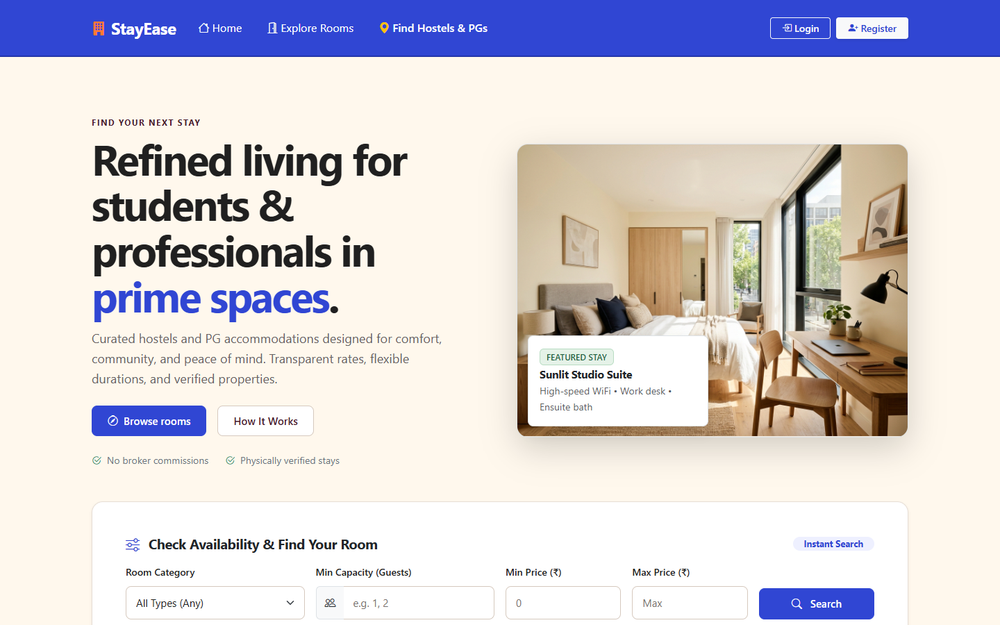
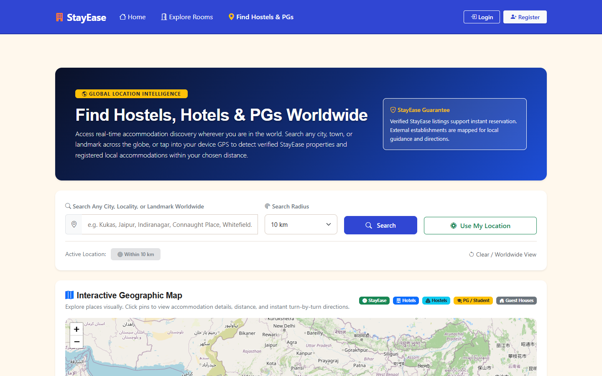
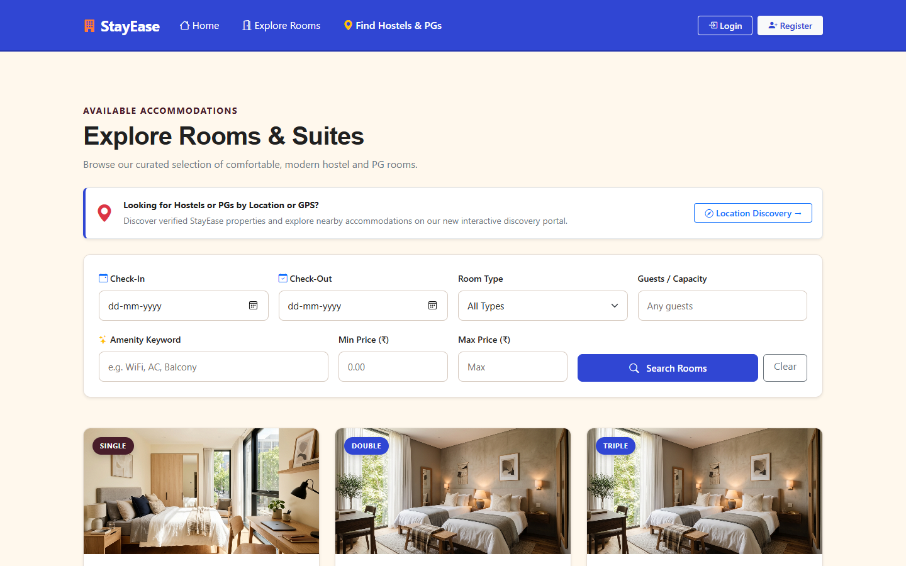
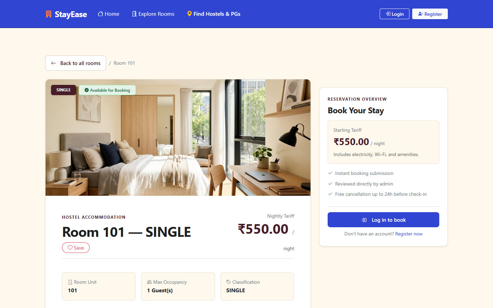
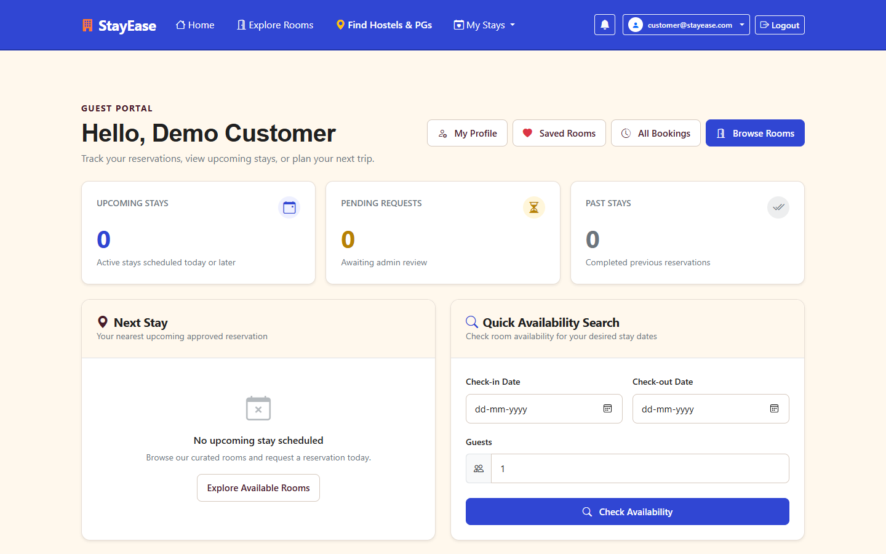
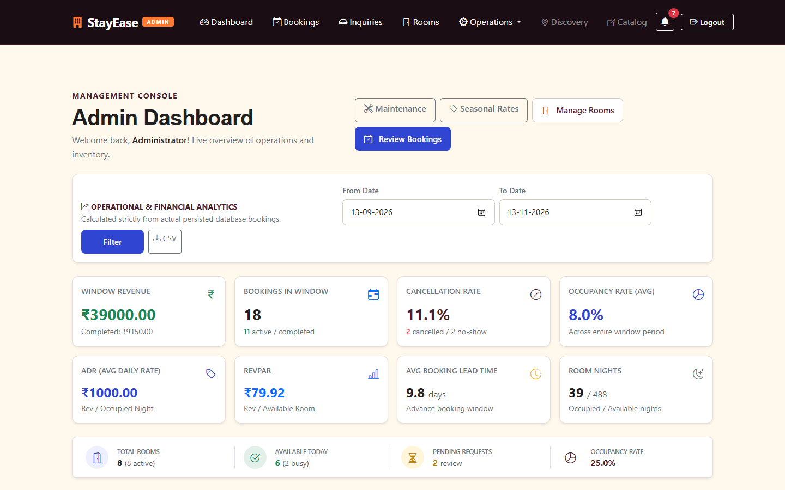

# StayEase — User Interface & System Visual Showcase

Explore the live user interfaces, customer workflows, geospatial discovery engine, and property management consoles across StayEase.

---

### 1. Public Landing Page & Destination Search
> **Route:** `/`  
> Editorial hospitality hero banner with real-time room availability preview, luxury accommodation typography, and curated stay highlights.

---

### 2. Worldwide Geospatial Discovery Portal & Interactive Map
> **Route:** `/discovery`  
> OpenStreetMap + Leaflet interactive map radar scanning up to 100 km radius with 220ms debounced typeahead autocomplete, displaying verified StayEase rooms and external registered hostels/PGs with zero API billing risk.

---

### 3. Accommodations Catalog & Filtering
> **Route:** `/rooms`  
> Multi-criteria filtering by Room Type (`SINGLE`, `DOUBLE`, `TRIPLE`, `DORMITORY`), guest capacity, price range, and date availability.

---

### 4. Room Details & Live Booking CTA
> **Route:** `/rooms/{id}`  
> High-resolution imagery, amenity badges, transparent pricing breakdown, and instant transactional booking CTA.

---

### 5. Customer Self-Service Dashboard
> **Route:** `/customer/dashboard`  
> Personalized customer hub spotlighting upcoming stays, active reservation tracking, web check-in, and printable verification vouchers.

---

### 6. Property Operations & Hospitality Analytics Console
> **Route:** `/admin/dashboard`  
> Live inventory ribbon (Total, Active, Occupied, Vacant), industry KPIs (**ADR**, **RevPAR**, **Occupancy Rate**), maintenance blackouts, and compliance audit trail with CSV export.

