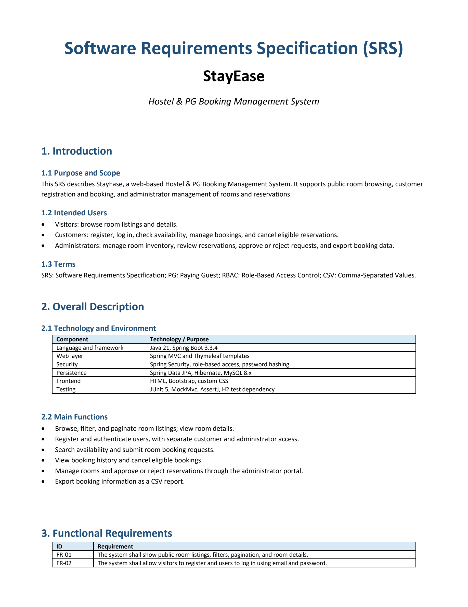
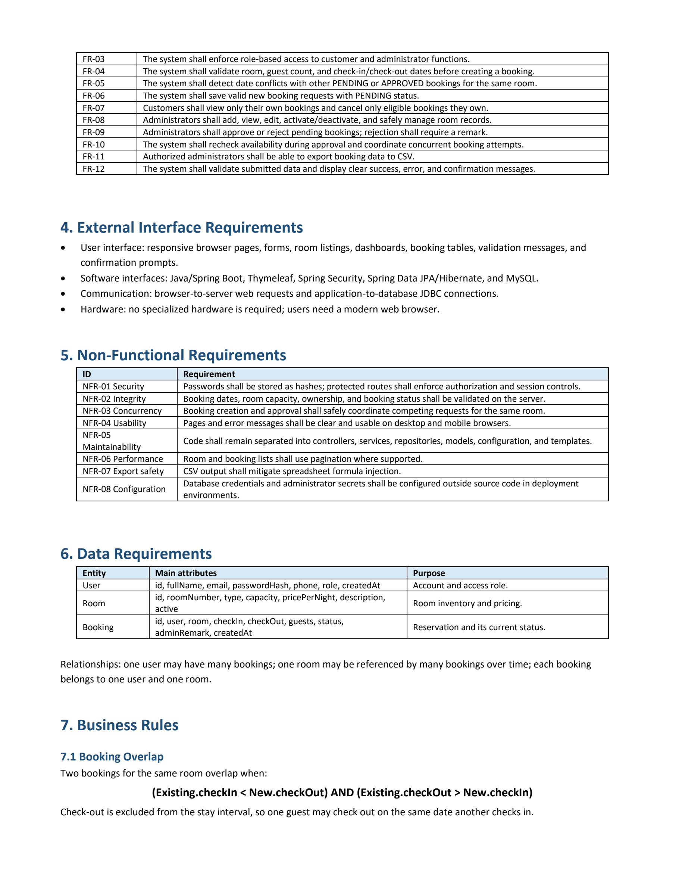
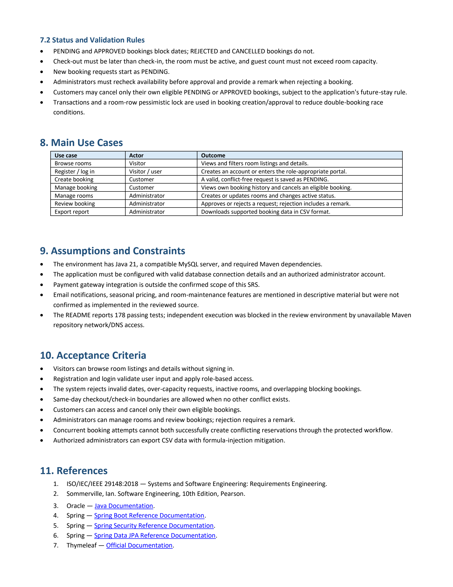

# Software Requirements Specification (SRS)

## StayEase — Hostel & PG Booking Management System

This document contains the official **Software Requirements Specification (SRS)** for the StayEase platform. Below are high-resolution page-by-page visual scans of the SRS document, along with a link to download the original PDF.

📄 **Download Original PDF:** [StayEase_SRS.pdf](srs/StayEase_SRS.pdf)

---

### Page 1: Introduction, Overall Description & Functional Requirements (FR-01 to FR-02)

---

### Page 2: Functional Requirements (FR-03 to FR-12), External Interfaces, NFRs & Business Rules

---

### Page 3: Status & Validation Rules, Main Use Cases, Assumptions, Acceptance Criteria & References

---

## SRS Summary Table

| Section | Topic | Highlights |
|---|---|---|
| **1. Introduction** | Purpose & Scope | Web-based Hostel & PG booking system for visitors, customers, and admins. |
| **2. Overall Description** | Tech Stack & Architecture | Java 21 LTS, Spring Boot 3.3.4, Spring Security, Spring Data JPA, MySQL 8, Thymeleaf. |
| **3. Functional Requirements** | FR-01 to FR-12 | Room catalog, user authentication, RBAC, conflict detection, booking CRUD, CSV reports. |
| **4. External Interfaces** | UI, Software & Hardware | Responsive browser UI, JDBC connections, modern browser support. |
| **5. Non-Functional Requirements** | NFR-01 to NFR-08 | BCrypt hashing, server-side date validation, pessimistic concurrency lock, pagination, CSRF safety. |
| **6. Data Requirements** | Core Entities | `User`, `Room`, `Booking` relationships and domain attributes. |
| **7. Business Rules** | Overlap Algorithm | `(Existing.checkIn < New.checkOut) AND (Existing.checkOut > New.checkIn)`. Back-to-back stays supported. |
| **8. Main Use Cases** | Core Workflows | Browse rooms, register/login, create booking, manage rooms, approve/reject, export CSV. |
| **9. Assumptions & Constraints** | Technical Bounds | Java 21, MySQL 8, Maven dependencies. |
| **10. Acceptance Criteria** | Quality Benchmarks | Overbooking prevention, role restrictions, audit logging, input validation. |
| **11. References** | Standards | ISO/IEC/IEEE 29148:2018, Sommerville Software Engineering 10th Ed, Spring & Java Docs. |
